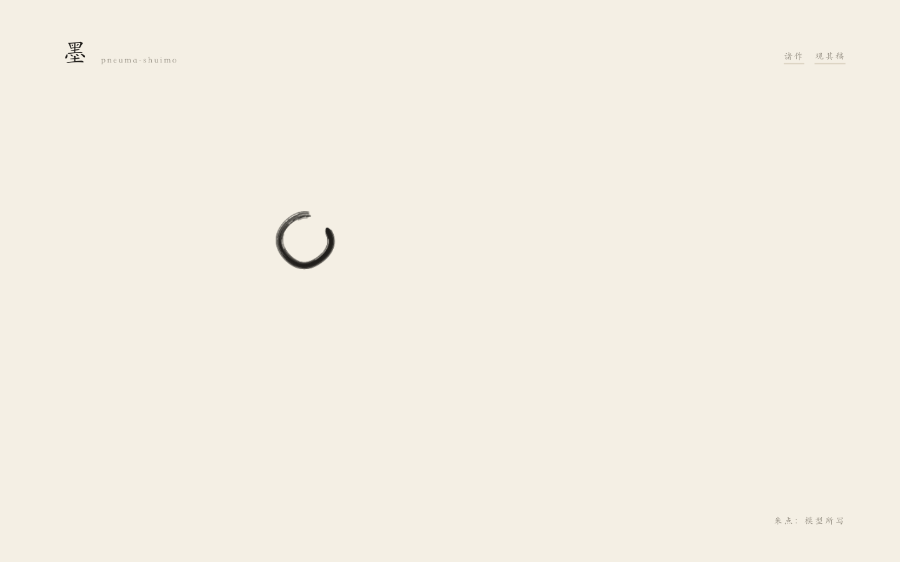
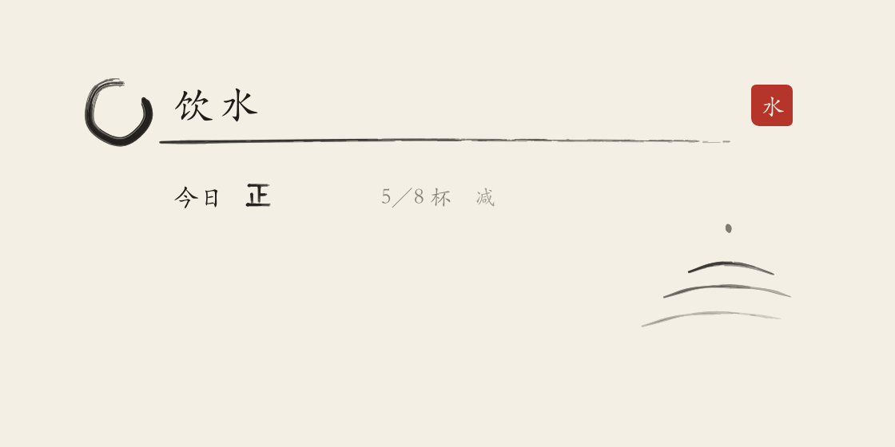
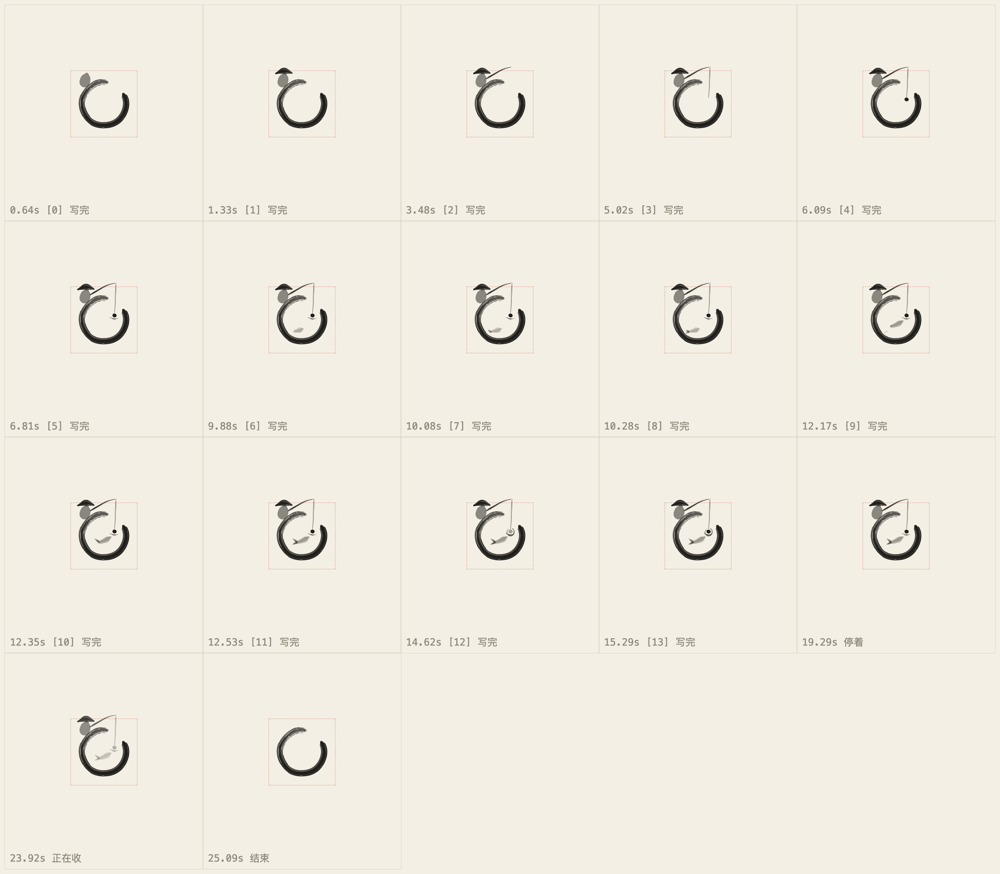

# 墨 · pneuma-shuimo

一张空白的纸，一个墨圆。圆是助理，它是活的；主人说一句话，它从圆里写出一样能用的东西。

Agent 只写一份 JSON。笔毛、干湿浓淡、摆放和时间都由播放器负责，所以无论哪个模型写，出来的是同一只手。

**在线看：<https://shuimo.vibecoding.icu>**



## 它是什么

一套给 AI 助理用的水墨界面基建，五样东西：

| | |
|---|---|
| **播放器** | Canvas 2D 上的笔毛引擎，加上两个入口：`summon()` 召出头像，`mount()` 让一样东西长出来 |
| **脚本** | 纯数据的 JSON，没有代码、颜色、字号 |
| **Skill** | 教 Agent 写脚本的两份说明：[`skill/SKILL.md`](skill/SKILL.md)、[`skill/PIECE.md`](skill/PIECE.md) |
| **质检** | 校验器（错在哪、怎么改，一句一句）和给模型的眼睛看的截图工具 |
| **示例** | 五样长出来的东西，五幅小品，外加模型只凭 skill 写出来的十份 |

没有依赖，没有构建，纯 ES 模块。

## 两种内容，一支笔

| | 灵：活的头像 | 生：长出来的东西 |
|---|---|---|
| 是什么 | 圆自己的表演。闲时慢慢写一幅；指针来了演两三秒；被撞见会回应 | 从圆里拉出一笔，写出一样能用的小东西：记数、打卡、清单 |
| Agent 写的 | 小品，[`pieces/*.json`](pieces) | 脚本，[`examples/*.json`](examples) |
| 播放 | `summon()` | `mount()` |
| 校验 | `validatePiece()` | `validate()` |
| Skill | [`skill/PIECE.md`](skill/PIECE.md) | [`skill/SKILL.md`](skill/SKILL.md) |
| 质检 | `tools/film.mjs` | `tools/check.mjs`、`tools/shoot.mjs` |

### 生：一份脚本，一样能用的东西

主人说“帮我记每天喝了几杯水，一天八杯”，Agent 写下这些：

```json
{
  "format": 1,
  "id": "water",
  "title": "饮水",
  "intent": "帮我记每天喝了几杯水，一天八杯。",
  "rows": [
    { "kind": "tally", "key": "cups", "label": "今日", "goal": 8, "unit": "杯" }
  ],
  "ink": { "motif": "ripples" },
  "seal": "水",
  "resets": "daily"
}
```

播放器把它写出来。点一下添一笔“正”字，过了午夜清零，钤上印就留下：



行有四种：`text` 一句话，`check` 打卡，`tally` 计数，`entry` 清单。小画可以用内置的六种（兰、竹、山、水纹、月、梅），也可以由 Agent 自己一笔一笔画。

### 灵：一幅小品，圆自己的戏

小品是一串笔画，每一笔写在哪、多宽、多湿、多快。让东西“动”的只有三个字段：`fleeting`（写完自己干去）、`replaces`（这一笔开始时那一笔干去）、`moved`（此前的都干去）。

下面是 Opus 5.5 只凭 skill 写的「独钓」，`film.mjs` 每写完一笔拍一格：



## 几条定下来的规矩

- **只有写和干。** 纸上没有任何东西移动、旋转、拉伸或缩放。“动”是这一笔干去、下一笔写在别处。
- **从圆来，回圆去。** 小品结束时所有墨都干去，只剩圆；长出来的东西点一下圆就干回去。
- **脚本是纯数据。** 上纸之前必过校验。被拒的理由是一句句“哪里错、怎么改”，可以原样退给 Agent。
- **分工。** Agent 决定内容：叫什么、有哪几行、画什么、怎么演。播放器决定摆放和笔法。
- **墨管生灭，纸和字管内容。** 标题和行是真的文字，输入框是真的输入框；笔毛只画圆、那一笔、圈、点、“正”字和小画。
- **每一笔都不一样。** 同一份脚本每次写出来都有细微的出入，由种子决定；种子为 0 时照原样写。
- **质检是给模型的眼睛准备的。** 校验器管格式、边界、时长和几条能量化的法度；像不像、好不好，靠模型自己看图。

## 看

```sh
git clone https://github.com/pandazki/pneuma-shuimo.git
cd pneuma-shuimo
node tools/serve.mjs          # http://127.0.0.1:4173/demo/
```

需要 Node 22 以上。

首页只有一张纸和它自己：

- 它用一两个字说自己在做什么：墨、在、顾、行、思、书、成……
- 指针靠近，圆里朝着指针的那一侧晕开一层淡墨；停在它身上，它演一小段。
- **拖**：按住它带着走。
- **说**：右边竖排的是主人会说的话。点一句，或者把它拖到那句话上，它过去，想一想，做一做，然后从它自己身上把东西写出来。写出来的是真的，可以点、可以填。再点它，收回去。
- **戏**：另外几句让它自己玩：钓鱼、喝茶、睡一会儿、放空。
- **合**：把它拖到左上角的「墨」字上，它绕着字写一整圈，合上口，成了题字的一部分。按住这个圈可以再把它带出来。
- 没人理它时，它自己挑一句做给你看。

首页上的话对应的脚本是事先写好的，带朱点的是模型写的；演示里没有接模型。

其他几页：

| 页面 | 内容 |
|---|---|
| `/demo/board.html` | 全部案例陈列在一屏上 |
| `/demo/avatar.html` | 单个头像，逐幅点播小品 |
| `/demo/sheets.html` | 全部长出来的东西，可以真的用 |
| `/demo/motifs.html` | 内置的六种小画 |

## 装进应用

目前还没有发布到 npm，直接从仓库装：

```sh
npm install github:pandazki/pneuma-shuimo
```

```js
import { summon, mount, validate, validatePiece } from 'pneuma-shuimo';
import 'pneuma-shuimo/player.css';

// 头像
const spirit = summon(el, {
  size: 56,
  pieces,                                   // 通过 validatePiece 的小品
  idle: { first: [75e3, 150e3], between: [150e3, 330e3] },
  onPress: openChat,
});
spirit.set('thinking');                     // rest · thinking · working · blank
spirit.set('working');
spirit.done();                              // 做完：一笔合口，回到静

// 长出来的东西
const verdict = validate(scriptFromAgent);
if (!verdict.ok) return verdict.errors;     // 原样退给 Agent
const sheet = mount(el, scriptFromAgent, {
  state, kept,                              // 宿主保存的状态
  onState: save, onKeep: setKept,
  circle: false,                            // 从头像的圆里长出来，自己不再画圆
});
```

- 校验器不碰 DOM，后端可以单独引：`import { validate } from 'pneuma-shuimo/script'`。
- 颜色和字体用 CSS 变量：`--shuimo-paper`、`--shuimo-ink`、`--shuimo-cinnabar`、`--shuimo-font`。墨色取容器的 `color`。
- 全部类型在 [`src/index.d.ts`](src/index.d.ts)。
- 头像还有几个给宿主编排用的方法：`look()` / `unlook()`（注意偏向某一侧）、`play(piece)`（点播一幅）、`ink()`（再写它自己的一笔）、`dryAway()` / `rewrite()`（在原处干去、在新处写出来）。首页的拖动、一笔过去、合入题字都是用这几样在页面里拼的，见 [`demo/index.html`](demo/index.html)。

## 让 Agent 写

把 `skill/` 和 `tools/` 交给 Agent。它的流程是：读 skill，写 JSON，跑校验，看图，改，交付。

```sh
node tools/check.mjs examples/water.json                 # 校验，打印时间表
node tools/shoot.mjs examples/water.json --out shots     # 刚写完、用到一半、用满、小画放大
node tools/film.mjs pieces/sprout.json --out shots       # 小品：校验 + 连续画面 + 定格放大
```

`shoot` 和 `film` 需要本机有 Chrome；不在默认位置时用环境变量 `CHROME` 指明。

这套 skill 是试出来的：每次起一个没有任何上下文的 Opus 5.5，只给一句主人的话和 skill 的路径，让它写、自己看图、交付，再根据它的反馈改 skill。九次试写的产物在 [`trials/`](trials)，过程和结论在 [EXPERIMENT.md](EXPERIMENT.md)。

## 目录

```
src/
  brush.js     笔：一束笔毛，提按、干湿、浓淡，带种子的出入
  paper.js     纸：每笔一层，只有写和干
  layout.js    长出来的东西怎么摆、先写哪一笔
  script.js    脚本的校验
  player.js    mount()
  motifs.js    内置小画
  piece.js     小品的校验和时间表
  spirit.js    summon()
  player.css
  index.js · index.d.ts
skill/         给 Agent 的两份说明
tools/         check · shoot · film · serve · build
examples/      长出来的东西（示例）
pieces/        小品（示例）
trials/        模型只凭 skill 写的；shelved/ 是后来撤下的
demo/          演示页
tests/
```

## 开发

```sh
node --test tests/            # 31 条：格式、边界、每个示例都通过校验、小品结束只剩圆
node tools/build.mjs          # 把演示打成静态站点，输出到 dist/
```

## 还没做的

- 没有接模型。首页用的是事先写好的脚本；“主人说一句话 → Agent 当场写出来”这条链路要宿主自己接。
- 没有 Agent 写完之后的“看了再留”界面（试播、留下、删掉）。
- 拖动、一笔过去、合入题字现在写在演示页里，还没有收进库。
- 深色的纸只换了墨色，没有调过。
- 长出来的东西宽度固定 460px；只有四种行，没有数字输入、选择、时间。
- 清单会按 `max` 预留空白；条目不能单独删除。
- 没有测过同屏多个头像和低端机的性能。

## 许可

[MIT](LICENSE)
